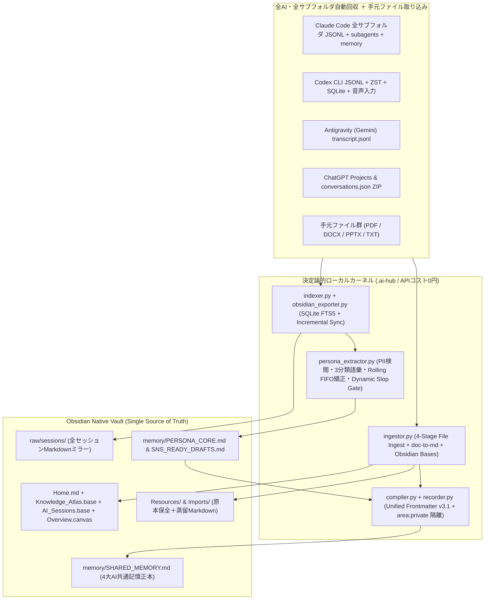

# Cross-AI Memory & Self-Improving Persona Hub (v3.1 Obsidian Native Edition)

OpenAI Codex（CLI / Desktop / SQLite / ZST）、Anthropic Claude（Code全サブフォルダ / Desktop / subagents / memory）、Google Antigravity（Gemini）、および ChatGPT（Projectフォルダ / エクスポートJSON / 音声ディクテーション）が混在する**あらゆるユーザーの環境**において、以下をワンコマンドで自動構築・常時同期する汎用スキルです。

1. **環境非依存の自動検出（Zero-Hardcode Discovery）**:
   - 実行ユーザーの `$HOME`、OS（macOS / Linux / WSL / Windows）、既存のObsidian Vault（`obsidian.json` から自動検出）、およびオーナー名を動的に特定。ハードコードされたパスや特定個人の設定は一切不要。
2. **ホーム配下の全サブフォルダ・4大AIチャット完全回収（Full Subfolder Harvesting）**:
   - `~/.claude/projects/<全サブフォルダ>/**/*.jsonl`（サブエージェント含む）、`~/.claude/history.jsonl`、Claude Desktop App
   - `~/.codex/sessions/**/*.jsonl`、`~/.codex/archived_sessions/*.jsonl.zst`、SQLite 3種（`state_5.sqlite`, `thread_history_1.sqlite`, `memories_1.sqlite`）、音声入力（`transcription-history.jsonl`）
   - `~/.gemini/antigravity/brain/*/transcript.jsonl`
   - ChatGPTプロジェクトフォルダ（`~/.codex/.chatgpt-projects/**`）および `conversations.json` エクスポート
3. **Obsidian Native データベースUI & 4ステージ資料蒸留（v3.1 統合機能）**:
   - **Obsidian Bases (`.base`) 自動構築**: `Knowledge_Atlas.base`（全ナレッジ・Playbook・案件一覧）、`AI_Sessions.base`（全AIチャット履歴テーブル）、`Persona_&_SNS.base`、`Overview.canvas`、`Home.md`（MOC）を自動配備。
   - **4ステージ非破壊ファイル取り込み (`ai-memory ingest`)**: 手元のPDF/DOCX/PPTX/TXT等を `Imports/` に原本保全しつつ、`doc-to-md` / 標準パーサとPIIサニタイザを通して `Resources/` へクリーンMarkdownとして蒸留し、`SHARED_MEMORY.md` へ自動反映。
   - **非公開ノート自動隔離 (`area: private`)**: フロントマターに `area: private` を指定したノートはAI共通記憶やSNSドラフトから決定論的に除外。
   - 詳細は [references/OBSIDIAN_NATIVE_GUIDE.md](references/OBSIDIAN_NATIVE_GUIDE.md) を参照。
4. **閉ループ自己改善型・人格コピー＆SNS直結エンジン（Self-Improving Persona & SNS OS）**:
   - 対話が増えるほど、本人の**「使う言葉（思想・語彙）」「反応する言葉（違和感・問い）」「行動する言葉（意思決定・号令）」**、およびAIへの**ダメ出し・軌道修正（「〜はNG」「そうじゃなくて」等）**を Rolling FIFO で自動学習。
   - `PERSONA_CORE.md`、`VOICE_LOG.md`、`SNS_READY_DRAFTS.md` をアトミック更新し、決定論的Slop Gate（AI構文排除・動的NGルール検閲・100点満点採点）を通過したSNS投稿ドラフト（X / Threads / note）を常時生成。

---

## 1. どんな人の環境にも適用できるワンコマンド導入手順（Universal Setup）

別のPCや別のユーザーの環境にこのスキルフォルダ（`cross-ai-memory-hub`）を配置し、以下の1コマンド（または `Install_Mac.command` / `Install_Windows.bat` のダブルクリック）を実行するだけで全自動構築が完了します。

```bash
# 1. 環境スキャン（変更を加えずに検出状況だけを確認する場合）
python3 scripts/universal_hub_installer.py --diagnose-only

# 2. ワンコマンド完全導入（Obsidian確認＋Vault構築＋Bases生成＋エンジン配備＋初回同期＋10分毎自動同期デーモン登録）
bash scripts/setup_obsidian.sh [任意のVaultパス] ["オーナー氏名"]

# または Python インストーラーを直接実行（細かいオプション指定時）
python3 scripts/universal_hub_installer.py \
  --vault ~/Obsidian/MyVault \
  --persona-name "山田太郎" \
  --workspace ~/Projects/my-workspace \
  --sync-now \
  --install-daemon
```

---

## 2. システムアーキテクチャ（4-Layer Knowledge + Obsidian Native Bases + Self-Improving Persona Loop）



---

## 3. 日常運用コマンド（CLI Reference）

インストール完了後、`~/.local/bin` に以下の2つのCLIが配備され、どのAI（Codex / Claude Code / Antigravity）からも共通で呼び出せます。

```bash
# 全AIチャット履歴＋Obsidian Vaultの横断検索
ai-memory search "<キーワード>"
chat-archive search "<キーワード>"

# 特定セッションの全文復元表示
chat-archive show <session_id>

# 手元のファイルやフォルダを4ステージ非破壊蒸留してObsidianへ取り込み
ai-memory ingest "<ファイルまたはフォルダのパス>" --area <work|personal|private>

# Obsidian Bases (.base) / Overview.canvas / Home.md の生成・修復
ai-memory scaffold

# 人格コピー（使う・反応する・行動する言葉）＆SNSドラフトの表示・手動更新
ai-memory persona --mode core
ai-memory persona --mode sns
ai-memory persona --mode sync

# 新しい意思決定・教訓・戦略をObsidian Vaultへ構造化記録 (Unified Schema v3.1)
ai-memory record --type <lesson|project|strategy|playbook|entity|adr> --area <work|personal|private> --title "タイトル" --content "内容"

# 全AIログの手動差分同期＆共通記憶リコンパイル
chat-archive sync && ai-memory sync

# 統合オンボーディング（Vault構造4問 ＋ 人格シード3問 ＝ 計7問）＆環境診断
ai-memory onboard --diagnose
ai-memory onboard --interview
ai-memory onboard --open-chatgpt

# 意味上の矛盾（Semantic Contradictions）＆価値観の優先順位（Value Priorities）の日次スキャン＆裁定
ai-memory contradictions --scan
ai-memory contradictions --next-value
ai-memory contradictions --ask
ai-memory contradictions --resolve <ID> --choice <A|B|BOTH|DISMISS> --note "優先順位・使い分け条件"
ai-memory values --ask

# ヘルスチェック（全項目診断）
python3 scripts/health_check.py
```

---

## 4. 内蔵エージェントによる現実的制約の自律検知・ユーザー誘導（Built-in Onboarding Coach）

他の人の環境へ導入した際に起こりうる「3大限界」を `onboarding_coach.py`（および `SHARED_MEMORY.md` の `§6. 内蔵エージェントからの環境最適化・ユーザー案内`）が自動検知し、**内蔵エージェントからユーザーへ具体的な指示・インタビューを出すことで100%解決**します。

1. **【制約①】ChatGPT Web版の履歴がローカルに自動保存されない問題**:
   - **自動解凍インポーター**: ユーザーがChatGPTの「設定 ＞ データコントロール ＞ データをエクスポート」から届いたメールの **ZIPファイルを `~/Downloads`（ダウンロードフォルダ）に保存するだけ（解凍不要）** で、`indexer.py` がZIP内の `conversations.json` を自動検出・展開・Obsidian統合します。
   - **エージェントからの案内**: 未取り込みの場合、内蔵エージェントが `ai-memory onboard --open-chatgpt` でブラウザの設定画面を直接開き、3クリック手順を案内します。
2. **【制約②】AI利用歴が浅いユーザーの「コールドスタート問題（初期の発話ログ不足）」**:
   - **5問の人格シード・インタビュー**: 抽出できるユーザー発言が50件未満の環境では、内蔵エージェントが自動的に **5つのコア質問（①使う言葉・価値観、②違和感・義憤、③共鳴する姿勢、④行動の号令、⑤絶対NG表現）** をユーザーにインタビューします（CLI対話 `ai-memory onboard --interview` またはチャット上でAIが直接ヒアリングして `ai-memory onboard --seed-philosophy ...` で保存）。
   - 回答結果は `memory/PERSONA_SEEDS.md` に保存され、**過去ログが0件の人でも導入初日から本人らしさ100%の `PERSONA_CORE.md` と `SNS_READY_DRAFTS.md` が生成**されます。
3. **【制約③】Windowsネイティブ環境（非WSL）や `zstd` 未導入環境での制限**:
   - **自動フォールバック＋設定案内**: Windowsで開発者モードがOFFでも管理者権限不要のディレクトリジャンクション（`mklink /J`）およびタスクスケジューラ（`schtasks`）へ自動フォールバックしつつ、内蔵エージェントが「開発者モードのON手順（`start ms-settings:developers`）」や `zstd` 導入コマンドをユーザーに案内します。

---

## 5. 日次・意味上の矛盾検知＆価値観の優先順位（Value Hierarchy）裁定タスク

自己改善ループで蓄積されたルールや過去メモリ・正典の間に**「意味上の矛盾」**が生じた場合、および**「どちらも大切だが、いざ衝突した時にどちらを優先するか（価値観の優先順位・トレードオフ）」**を、毎日定期的に検出・出題してユーザーに判断を仰ぎます（`contradiction_resolver.py`）。

1. **3層の矛盾検知 ＋ 価値観トレードオフ出題アルゴリズム**:
   - **① 7大意味極性軸（Semantic Polarity Axes）**: 文体（敬体 vs 常体）、出力密度（1〜3行即答 vs 丁寧な教育解説）、構造（箇条書き・表 vs 箇条書き排除・連続散文）、承認範囲（一括自律実行 vs 都度人間承認 `force_l0`）、絵文字・記号、主張スタンス、専門度。
   - **② 同一トピックの肯定/禁止衝突 ＆ 案件の状態矛盾**: 同じ対象語に対して「必ず使う」と「禁止/NG」が衝突しているケースや、同一案件で「稼働中」と「停止中」が混在しているケース。
   - **③ 5大コア価値観トレードオフ軸 ＋ 動的価値観ペア抽出（Value Priority Trade-Offs）**:
     - `val-vision-vs-cashflow`: **長期の大義・物語 vs 今日の一点突破・足元の売上**
     - `val-automation-vs-process`: **AIによる0秒自動化・効率 vs 人間が歩む泥臭いプロセス・体温**
     - `val-tolerance-vs-boundary`: **寛容・寄り添う愛 vs 甘えを許さない厳格な境界線（力愛不二）**
     - `val-speed-vs-perfection`: **圧倒的スピード・即断即決 vs 証拠主義・100%品質検証**
     - `val-authenticity-vs-reach`: **本質・こだわりの純度 vs 初心者にも伝わる平易さ・間口の広さ**
     - さらに、抽出されたユーザー独自の思想キーワード上位ペアの優先順位も動的に生成します。
2. **毎日定期実行（08:45 定時ジョブ ＋ バックグラウンド同期連動）**:
   - 毎朝 `08:45`（macOS `launchd` / Linux `cron` / Windows `schtasks` ＋ `auto-sync-obsidian.sh` の日次チェック）に自動スキャンを実行し、矛盾がない日も未確定の「価値観の優先順位（Value Priority）」を1日1問ずつキューに追加します。
   - Obsidianの `memory/CONTRADICTION_INBOX.md` と `SHARED_MEMORY.md` の `§7. 意味上の矛盾チェック＆価値観の優先順位` に書き出し、AIがユーザーへ **「Aを最優先 / Bを最優先 / 時間帯・条件分けで両方維持（BOTH）」** の判断を仰ぎます。
   - ユーザーが回答すると、`persona_learning_state.json` の `value_hierarchy`（確定した価値観の優先順位）に永久刻印され、`PERSONA_CORE.md` と `SHARED_MEMORY.md` に即座に反映されます。


