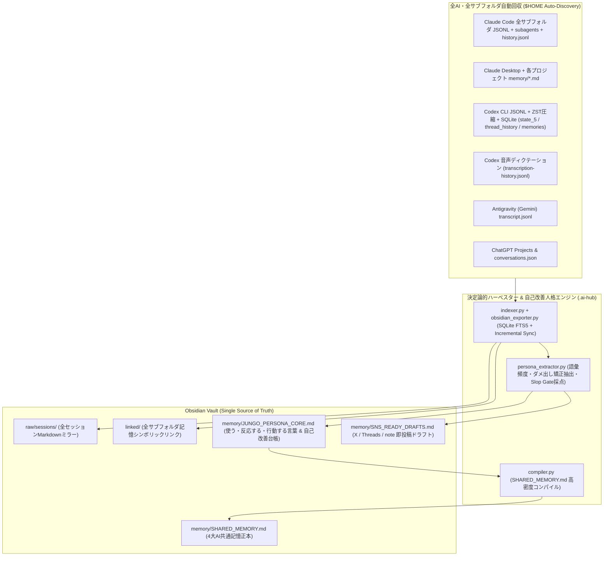

# Cross-AI Memory & Self-Improving Persona Hub (v2.0 Universal Edition)

OpenAI Codex（CLI / Desktop / SQLite / ZST）、Anthropic Claude（Code全サブフォルダ / Desktop / subagents / memory）、Google Antigravity（Gemini）、および ChatGPT（Projectフォルダ / エクスポートJSON / 音声ディクテーション）が混在する**あらゆるユーザーの環境**において、以下をワンコマンドで自動構築・常時同期する汎用スキルです。

1. **環境非依存の自動検出（Zero-Hardcode Discovery）**:
   - 実行ユーザーの `$HOME`、OS（macOS / Linux / WSL）、既存のObsidian Vault（`obsidian.json` から自動検出）、およびオーナー名（`--persona-name` / `git config user.name` / OSアカウント名）を動的に特定。ハードコードされたパスや特定個人の設定は一切不要。
2. **ホーム配下の全サブフォルダ・4大AIチャット完全回収（Full Subfolder Harvesting）**:
   - `~/.claude/projects/<全サブフォルダ>/**/*.jsonl`（サブエージェント含む）、`~/.claude/history.jsonl`、Claude Desktop App
   - `~/.codex/sessions/**/*.jsonl`、`~/.codex/archived_sessions/*.jsonl.zst`、SQLite 3種（`state_5.sqlite`, `thread_history_1.sqlite`, `memories_1.sqlite`）、音声入力（`transcription-history.jsonl`）
   - `~/.gemini/antigravity/brain/*/transcript.jsonl`
   - ChatGPTプロジェクトフォルダ（`~/.codex/.chatgpt-projects/**`）および `conversations.json` エクスポート
3. **4層知識アーキテクチャ & FTS5全文検索（Obsidian Single Source of Truth）**:
   - `raw/sessions/{claude,codex,antigravity}/`: 全セッションを決定論的フロントマター付きMarkdownとしてミラーリング（`.gitignore` 自動保護でGit肥大化を防止）
   - `linked/`: 各AIの散在メモリフォルダ（`claude-workspaces/`, `codex-memories/` 等）を動的シンボリックリンクで一元化
   - `wiki/`: 構造化ナレッジグラフ（`entities/`, `strategies/`, `playbooks/`, `cases/`）
   - `memory/`: 全AI共通の正本 `SHARED_MEMORY.md` ＆ `CHAT_ARCHIVE.md`
4. **閉ループ自己改善型・人格コピー＆SNS直結エンジン（Self-Improving Persona & SNS OS）**:
   - 対話が増えるほど、本人の**「使う言葉（思想・語彙）」「反応する言葉（違和感・問い）」「行動する言葉（意思決定・号令）」**、およびAIへの**ダメ出し・軌道修正（「〜はNG」「そうじゃなくて」等）**を自動学習。
   - `JUNGO_PERSONA_CORE.md`（または `PERSONA_CORE.md`）、`JUNGO_VOICE_LOG.md`、`SNS_READY_DRAFTS.md` を自動更新し、決定論的Slop Gate（AI構文排除・100点満点採点）を通過したSNS投稿ドラフト（X / Threads / note）を常時生成。

---

## 1. どんな人の環境にも適用できるワンコマンド導入手順（Universal Setup）

別のPCや別のユーザーの環境にこのスキルフォルダ（`cross-ai-memory-hub`）を配置し、以下の1コマンドを実行するだけで全自動構築が完了します。

```bash
# 1. 環境スキャン（変更を加えずに検出状況だけを確認する場合）
python3 scripts/universal_hub_installer.py --diagnose-only

# 2. ワンコマンド完全導入（Obsidian確認＋Vault構築＋エンジン配備＋初回同期＋10分毎自動同期デーモン登録）
bash scripts/setup_obsidian.sh [任意のVaultパス] ["オーナー氏名"]

# または Python インストーラーを直接実行（細かいオプション指定時）
python3 scripts/universal_hub_installer.py \
  --vault ~/Obsidian/MyVault \
  --persona-name "山田太郎" \
  --workspace ~/Projects/my-workspace \
  --sync-now \
  --install-daemon
```

---

## 2. システムアーキテクチャ（4-Layer Knowledge + Self-Improving Persona Loop）



---

## 3. 日常運用コマンド（CLI Reference）

インストール完了後、`~/.local/bin` に以下の2つのCLIが配備され、どのAI（Codex / Claude Code / Antigravity）からも共通で呼び出せます。

```bash
# 全AIチャット履歴＋Obsidian Vaultの横断検索
ai-memory search "<キーワード>"
chat-archive search "<キーワード>"

# 特定セッションの全文復元表示
chat-archive show <session_id>

# 人格コピー（使う・反応する・行動する言葉）＆SNSドラフトの表示・手動更新
ai-memory persona --mode core
ai-memory persona --mode sns
ai-memory persona --mode sync

# 新しい意思決定・教訓・戦略をObsidian Vaultへ構造化記録
ai-memory record --type <lesson|project|strategy|playbook> --title "タイトル" --content "内容"

# 全AIログの手動差分同期＆共通記憶リコンパイル
chat-archive sync && ai-memory sync

# 内蔵エージェントによる環境制約診断＆5分間・初期人格コア抽出インタビュー
ai-memory onboard --diagnose
ai-memory onboard --interview
ai-memory onboard --open-chatgpt

# ヘルスチェック（全項目診断）
python3 scripts/health_check.py
```

---

## 4. 内蔵エージェントによる現実的制約の自律検知・ユーザー誘導（Built-in Onboarding Coach）

他の人の環境へ導入した際に起こりうる「3大限界」を `onboarding_coach.py`（および `SHARED_MEMORY.md` の `§6. 内蔵エージェントからの環境最適化・ユーザー案内`）が自動検知し、**内蔵エージェントからユーザーへ具体的な指示・インタビューを出すことで100%解決**します。

1. **【制約①】ChatGPT Web版の履歴がローカルに自動保存されない問題**:
   - **自動解凍インポーター**: ユーザーがChatGPTの「設定 ＞ データコントロール ＞ データをエクスポート」から届いたメールの **ZIPファイルを `~/Downloads`（ダウンロードフォルダ）に保存するだけ（解凍不要）** で、`indexer.py` がZIP内の `conversations.json` を自動検出・展開・Obsidian統合します。
   - **エージェントからの案内**: 未取り込みの場合、内蔵エージェントが `ai-memory onboard --open-chatgpt` でブラウザの設定画面を直接開き、3クリック手順を案内します。
2. **【制約②】AI利用歴が浅いユーザーの「コールドスタート問題（初期の発話ログ不足）」**:
   - **5問の人格シード・インタビュー**: 抽出できるユーザー発言が50件未満の環境では、内蔵エージェントが自動的に **5つのコア質問（①使う言葉・価値観、②違和感・義憤、③共鳴する姿勢、④行動の号令、⑤絶対NG表現）** をユーザーにインタビューします（CLI対話 `ai-memory onboard --interview` またはチャット上でAIが直接ヒアリングして `ai-memory onboard --seed-philosophy ...` で保存）。
   - 回答結果は `memory/PERSONA_SEEDS.md` に保存され、**過去ログが0件の人でも導入初日から本人らしさ100%の `PERSONA_CORE.md` と `SNS_READY_DRAFTS.md` が生成**されます。
3. **【制約③】Windowsネイティブ環境（非WSL）や `zstd` 未導入環境での制限**:
   - **自動フォールバック＋設定案内**: Windowsで開発者モードがOFFでも管理者権限不要のディレクトリジャンクション（`mklink /J`）およびタスクスケジューラ（`schtasks`）へ自動フォールバックしつつ、内蔵エージェントが「開発者モードのON手順（`start ms-settings:developers`）」や `zstd` 導入コマンドをユーザーに案内します。
